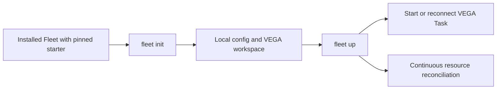
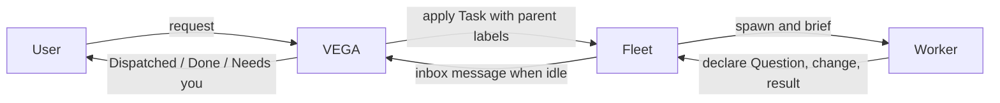

# VEGA

VEGA is the generic Mission Control workspace bundled with Fleet v2's engine:
instructions, prompts, three agent skills, a minimal runtime configuration and
one initial Task. Fleet is the engine; VEGA is editable content running as an
ordinary Task.

VEGA is dispatch-only. Every substantive deliverable, from design and research
through implementation, review, writing and operations, runs in a bounded worker
Task with its own workspace, however short or read-only. VEGA only routes and
steers work, resolves dependencies, checks recorded evidence and reports state.
Its rules are in [workspace/AGENTS.md](workspace/AGENTS.md).

| Targets | |
| --- | --- |
| Fleet | v2.7.3, resource API `fleet/v1alpha1`, native config schema 1 |
| Initial resources | Task `vega` only; TaskConfig, EnvProvider and ChangeRequest are optional |
| Not included | Engine install, harness login, engine code or controllers |

## Install and run

1. Install a compatible Fleet binary, Thurbox, `jq` and an authenticated
   supported harness. The starter defaults to `codex`; choose another harness
   before the initial Task is created, since its spec is then immutable except
   for `dispatch` and `forge`.
2. Run `fleet init`, then `fleet up`. See their help for config overrides and
   platform-specific discovery, and `fleet version --json` for the installed
   capabilities.

The released Fleet binary pins this starter at an exact source commit, so setup
needs neither Git nor a Fleet source checkout. `fleet init` / `fleet up` need
Fleet's bootstrap implementation; the Python v1 CLI does not support them.



`fleet up` owns reconciliation whether VEGA is busy or idle, reuses the persisted
Task and session on restart, and keeps an ambiguous runtime response unknown
instead of starting another Mission Control. These are engine guarantees; the
content cannot implement process recovery. All commands and worker briefs
address the same store via `--config PATH` or inherited `FLEET_CONFIG`; never
initialize a second store.

## How it works



- **Background work.** VEGA never waits in the foreground. Workers carry
  `gateway.fleet.dev/parent` labels, so Fleet relays their Questions, changes and
  results into VEGA's inbox.
- **Fleet as memory.** Order, limits, pending decisions and the request are
  `vega.fleet.dev/*` labels; held work has `dispatch` false. Agent memory holds
  user preferences only, so VEGA's context is disposable and rebuilt from
  the status digest. See [mission-control.md](workspace/prompts/mission-control.md).
- **Workspaces.** Worker Tasks use `spec.workspace.repositories`; the runtime
  creates the worktrees from source checkouts mapped in `runtime.repositories`,
  and by default deletes them, their branch and unpushed commits with the
  session. See [task-intake](workspace/.agents/skills/task-intake/SKILL.md).
- **Forge work.** Authorized workers open drafts, declare them with `fleet declare TASK
  --change-request URL` and end every post with `<!-- fleet:worker <task uid> -->`. Forge following needs an
  operator-configured `[forge.hosts]` entry and an authenticated forge CLI; the
  template configures neither, and Fleet does not merge changes. Creating a Task
  grants no permission to publish.
- **Coordination.** `fleet send TASK "MESSAGE"` queues inbox delivery; check
  its receipts, since queueing is not delivery. Direct prompts to an existing
  session follow
  [task-status](workspace/.agents/skills/task-status/SKILL.md).

The full engine contract is in Fleet v2.7.3's
[resource contracts](https://github.com/Thurbeen/fleet/tree/v2.7.3/docs/resources)
and [configuration contracts](https://github.com/Thurbeen/fleet/tree/v2.7.3/docs/configuration).

## Files

[starter.toml](starter.toml) is the schema-1 allowlist; only its listed assets
ship. Its `content_version` versions the content, not the Fleet engine, and does
not replace a source commit. Never package this checkout, its Git directory,
tests, local configuration or other files. [BOOTSTRAP.md](BOOTSTRAP.md) is the
rendering and update contract.

| Source | Installed purpose |
| --- | --- |
| `workspace/AGENTS.md` | VEGA's workspace instructions |
| `workspace/prompts/mission-control.md` | Startup and coordination prompt |
| `workspace/.agents/skills/task-intake/SKILL.md` | Create and dispatch a Task |
| `workspace/.agents/skills/task-status/SKILL.md` | Read Task state/evidence and coordinate with an existing session |
| `workspace/.agents/skills/status-digest/SKILL.md` | One line per Task, rebuilt from Fleet, and the labels that hold order and limits |
| `config/fleet.toml` | Working Thurbox runtime configuration |
| `tasks/vega.json` | JSON array containing the initial VEGA Task template |
| `LICENSE` | MIT license and retained attribution |

The skills are standard `SKILL.md` packages: from a checkout,
`npx skills add . --list` discovers them. Installing skills alone does not create
a Fleet config, workspace or VEGA Task.

## Customize and update

Keep personal additions in `CUSTOM.md` or `private/INSTRUCTIONS.md` inside the
installed workspace; neither ships. Never commit them, credentials, runtime
stores or personal Fleet config here, and add equivalent ignore rules if your
installed workspace lives in another Git repository. Ignore rules do not protect
secrets from an agent or another filesystem user.

You may edit the generated instructions. Updates preserve your edits and private
files and report changed managed files as conflicts; runtime configuration is
user-owned after first creation. Save customizations before updating and check
the engine's conflict report. Details are in [BOOTSTRAP.md](BOOTSTRAP.md).

## Verify source content

Contributors need Python 3.11 or newer, `uv`, `jq` and a Fleet
v2.7.3-compatible executable; there are no Python package dependencies. Set
`FLEET_BIN` to the executable's absolute path, then run:

```text
uv run --no-project python -m unittest discover -s tests -v
prek run --all-files
```

Using the real Fleet CLI with FakeRuntime, the tests install from the
allowlist into a path containing spaces, parse the unchanged production config,
and apply, brief and repeatedly reconcile VEGA without duplicating its identity.
They also check:

- Windows relative-path separators against the manifest;
- the dispatch-only boundary and delivery contract in every installed prompt;
- the forge worker rules, the optional resource examples, forge mutation, inbox
  delivery, declarations and result generation;
- repository workspaces through Fleet's Thurbox adapter with a recording
  `thurbox-cli` stand-in (POSIX only), including the unmapped-URL wait and the
  mapping check;
- worker reports into VEGA's inbox, the status digest, labels, the re-hydrate
  protocol, the word budget of always-read guidance and the ban on blocking
  waits.

They do not log in to a harness, start live Thurbox sessions or worktrees,
validate native Windows startup, or prove the engine's concurrent `init`/`up`
and update implementation; the engine repository owns those. Content checks
cannot prove a language model always obeys prose. There is no CI pipeline, so
the local gates are required before publishing; see [.publish.yaml](.publish.yaml).

## License and provenance

MIT, copyright 2026 Thurbeen, retained from Fleet's public MIT license. The forge
worker rules come from Fleet v2.1.0's bundled VEGA workspace; other guidance is
informed by Fleet v2.7.3's public contracts and checked against its CLI. Legacy
Python queue skills and operator configuration were not copied.
