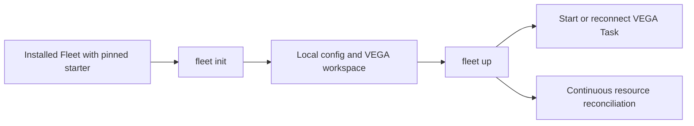

# VEGA

VEGA is the generic Mission Control workspace bundled with Fleet v2's
engine. It contains instructions, prompts, two agent skills, a minimal runtime
configuration and one initial Task. Fleet is the engine; VEGA is editable content
running as an ordinary Task.

VEGA is dispatch-only Mission Control. Every substantive requested deliverable—
from design and research through implementation, review, writing and operations—
runs in a bounded worker Task with its own prepared workspace. VEGA itself only
routes and steers work, including guarded direct prompts to an existing owned
Task session, resolves dependencies, checks recorded evidence and reports state.
A routine status check does not need a recursive Task; short or read-only work is
not an exception to dispatch.

Standing rules live once, in `workspace/AGENTS.md`; the startup prompt holds only
the startup steps. The task-intake skill defines the worker brief: the user's
request verbatim, then Goal, Constraints, Coordination and Done means, written
for a worker that shares no context, ending in the exact Fleet commands that
record its result against Mission Control's configuration.

This starter targets Fleet v2.1.0, resource API `fleet/v1alpha1` and native config
schema 1. That release also serves TaskConfig, EnvProvider and ChangeRequest;
these are optional and the initial bundle still creates only Task `vega`.
The `fleet init` / `fleet up` flow requires Fleet's bootstrap implementation;
it is not supported by the Python v1 CLI. This repository does not install an
engine or authenticate a harness.



## First run

Install a compatible Fleet binary, Thurbox and an authenticated supported harness.
The starter's default harness is `codex`; choose an available harness before the
initial Task is created if needed. Run `fleet init`, then `fleet up` and read
those commands' help for config overrides and platform-specific discovery.
Check `fleet version --json` and subcommand help for the installed capabilities.
The released Fleet binary must include this starter at an exact source commit;
initial setup needs neither Git nor a Fleet source checkout.

`fleet up` owns the reconciliation loop even when VEGA is busy or idle. Repeated
startup must reuse the persisted Task and session. An ambiguous runtime response
must remain unknown, rather than starting another Mission Control. These are
engine guarantees; the content itself cannot implement process recovery.

## Files and packaging

[starter.toml](starter.toml) is the schema-1 allowlist. Its `content_version`
is a content version, not a Fleet engine version or a substitute for a source
commit. Only its listed assets belong in a Fleet starter bundle. Do not package
this checkout, its Git directory, tests, local configuration or arbitrary files.

| Source | Installed purpose |
| --- | --- |
| `workspace/AGENTS.md` | VEGA's workspace instructions |
| `workspace/prompts/mission-control.md` | Startup and coordination prompt |
| `workspace/.agents/skills/task-intake/SKILL.md` | Write a worker brief, then create and dispatch its Task |
| `workspace/.agents/skills/task-status/SKILL.md` | Read Task state/evidence and coordinate with an existing session |
| `config/fleet.toml` | Working Thurbox runtime configuration |
| `tasks/vega.json` | JSON array containing the initial VEGA Task template |
| `LICENSE` | MIT license and retained attribution |

See [BOOTSTRAP.md](BOOTSTRAP.md) for the rendering and update contract.

## Customize and update

Keep personal additions in `CUSTOM.md` or `private/INSTRUCTIONS.md` inside the
installed workspace; neither is shipped. Do not commit those files, credentials,
runtime stores or personal Fleet config to this public repository. Add equivalent
ignore rules if you put your installed workspace in another Git repository.
Ignore rules do not protect secrets from an agent or another filesystem user.

You may edit the generated instructions. An update must preserve those edits and
private files, replace only unchanged managed baselines, and present changed
managed files as conflicts for review. A new bundle must not reset a workspace,
remove unrelated files or recreate its Task. Save customizations before trying
an update and inspect the engine's conflict report. Runtime configuration is
user-owned after first creation. Changing an existing Task's harness, brief or
workspace needs an explicit new Task; only `dispatch` and `forge` are mutable.

The skills are also standard `SKILL.md` packages. From a source checkout,
`npx skills add . --list` discovers them; install only the skills you need.
Installing skills alone does not create a Fleet config, workspace or VEGA Task.

## Fleet v2.1.0 capabilities

The canonical task-intake skill includes executable JSON examples for optional
TaskConfig/EnvProvider defaults. Apply those resources to the same store before
dispatching their Task. They are passive, mutable resources, separate from TOML;
the first successful launch resolution freezes privately. Provider file/command
sources are manager-local, including for remote workers. Keep credentials out of
literal resource data and protect the store and its plaintext snapshots.

Use `fleet send TASK "MESSAGE"` for inbox delivery, then check delivery receipts;
queueing is not proof of delivery. A retained Concluded session can still receive
feedback. The task-status skill explains execution identity, inboxes, declarations
and forge observations.

Mission Control can also use the configured runtime's documented CLI to prompt an
existing owned Task session directly. That path is for coordination, not substantive
work, and it does not create a Fleet inbox or delivery receipt. The task-status
skill resolves the exact session from Fleet state, verifies runtime identity and
safe input, distinguishes `sent`, `submitted`, `delivered_via` and process exit,
and prevents direct-plus-durable duplicate delivery. FakeRuntime validates the
starter lifecycle only; it does not simulate live local or remote terminal input.

Every authorized forge worker must open changes as drafts, immediately run
`fleet declare TASK --change-request URL`, and end every forge post with
`<!-- fleet:worker <task uid> -->` on its own line, using the uid from
`fleet get task TASK`. Include these requirements and the exact Fleet config path
in worker briefs. Publishing uses the repository's publishing skill or the
installed publish skill; creating a Task grants no publication permission.

Forge following needs an operator-configured `[forge.hosts]` entry and an
authenticated forge CLI. The minimal template configures neither. Fleet's
bootstrap renders the three shipped ready-policy definitions without choosing a
`draftPolicy`; policy and host selection remain operator choices. Configured
controllers mirror declared changes and relay feedback, and can mark drafts
ready under selected policy. Fleet does not merge changes. Task `forge` overrides
are mutable alongside dispatch; execution fields stay immutable. Result generation
comes from the delivered brief, even after a later forge/dispatch edit.

All commands and child briefs must address the same resolved configuration via
`--config PATH` or inherited `FLEET_CONFIG`. Do not initialize a second store.
See Fleet v2.1.0's [resource contracts](https://github.com/Thurbeen/fleet/tree/v2.1.0/docs/resources)
and [configuration contracts](https://github.com/Thurbeen/fleet/tree/v2.1.0/docs/configuration)
for the full engine contract. This starter adds no engine code or replacement
controller.

## Verify source content

Source contributors need Python 3.11 or newer, `uv`, and a Fleet v2.1.0-compatible
executable. No Python package dependencies are required. Set `FLEET_BIN`
to the absolute executable path, then run:

```text
uv run --no-project python -m unittest discover -s tests -v
prek run --all-files
```

The integration test creates
an isolated installation from the allowlist, parses the unchanged production
config through Fleet, and uses the real Task CLI with FakeRuntime to apply,
brief and repeatedly reconcile VEGA without duplicating its identity. It uses a
workspace path containing spaces and removes its own temporary tree. A second
end-to-end run simulates Windows relative-path separators to check manifest
portability; this does not replace native Windows runtime validation.

The regression also checks that the installed guidance expresses the
dispatch-only boundary, representative work categories, repository-free isolated
work, the orchestration/status exception, and the direct-versus-durable delivery
contract.

Two acceptance scenarios cover the brief and the startup surface. The skill's
example brief is dispatched through FakeRuntime, and the text the session
received must carry the five brief headings and Fleet commands that, run as
written against the test store, declare a change and conclude the Task. The
always-loaded startup context (workspace instructions, startup prompt and VEGA
brief) must stay within 1000 words, and each forge contract literal must have
one home among shipped files. Both scenarios first failed on the 0.4.0 content:
its example brief had no sections or runnable result command, and the startup
context was 1404 words with the forge rules stated twice. These content assertions validate delivered guidance and CLI contracts;
they cannot empirically prove that a language model will always obey prose or that
a simulated adapter proves live remote interaction.

The v2.1.0 regression first failed because a clean installation lacked the forge
worker rules. It now checks the installed guidance, executes the skill's optional
resource examples, verifies environment precedence and frozen defaults, mutates
forge settings, delivers an inbox message, declares facts and an offline
ChangeRequest mirror, and records a result with the delivered brief generation.

FakeRuntime is test-only. This test does not log in to a harness, start live
Thurbox sessions, validate Windows startup, or prove the engine's concurrent
`init/up` and update implementation. The engine repository owns those tests.
There is no CI pipeline in this initial source repository; local gates are
required before publication. See [.publish.yaml](.publish.yaml).

## License and provenance

MIT, copyright 2026 Thurbeen. The license is retained from Fleet's public MIT
license. The forge worker rules are retained from Fleet v2.1.0's bundled VEGA
workspace. Other workspace guidance is informed by that release's public resource
and configuration contracts and checked against the installed v2.1.0 CLI. Legacy
Python queue skills and operator configuration were not copied.
