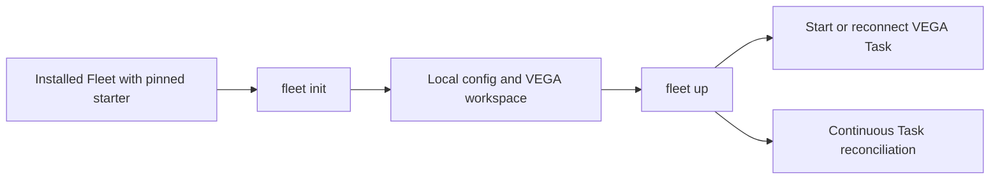

# VEGA

VEGA is the generic Mission Control workspace bundled with Fleet's Task-only
engine. It contains instructions, prompts, two agent skills, a default runtime
configuration and one initial Task. Fleet is the engine; VEGA is editable content
running as an ordinary Task.

This starter targets the Task-only `fleet/v1alpha1` API and config schema 1.
The `fleet init` / `fleet up` flow requires Fleet's bootstrap implementation;
it is not supported by the Python v1 CLI. This repository does not install an
engine or authenticate a harness.



## First run

Install a compatible Fleet binary, Thurbox and an authenticated supported harness.
The starter's default harness is `codex`; choose an available harness before the
initial Task is created if needed. Run `fleet init`, then `fleet up` and read
those commands' help for config overrides and platform-specific discovery.
The released Fleet binary must include this starter at an exact source commit;
initial setup needs neither Git nor a Fleet source checkout.

`fleet up` owns the reconciliation loop even when VEGA is busy or idle. Repeated
startup must reuse the persisted Task and session. An ambiguous runtime response
must remain unknown, rather than starting another Mission Control. These are
engine guarantees; the content itself cannot implement process recovery.

## Files and packaging

[starter.toml](starter.toml) is the schema-1 allowlist. Its `content_version`
is a content version, not a Fleet engine version or a substitute for a source
commit. Only its listed assets belong in a Fleet starter bundle. Do not package
this checkout, its Git directory, tests, local configuration or arbitrary files.

| Source | Installed purpose |
| --- | --- |
| `workspace/AGENTS.md` | VEGA's workspace instructions |
| `workspace/prompts/mission-control.md` | Startup and coordination prompt |
| `workspace/.agents/skills/task-intake/SKILL.md` | Create and dispatch a Task |
| `workspace/.agents/skills/task-status/SKILL.md` | Read Task state and evidence |
| `config/fleet.toml` | Working Thurbox runtime configuration |
| `tasks/vega.json` | JSON array containing the initial VEGA Task template |
| `LICENSE` | MIT license and retained attribution |

See [BOOTSTRAP.md](BOOTSTRAP.md) for the rendering and update contract.

## Customize and update

Keep personal additions in `CUSTOM.md` or `private/INSTRUCTIONS.md` inside the
installed workspace; neither is shipped. Do not commit those files, credentials,
runtime stores or personal Fleet config to this public repository. Add equivalent
ignore rules if you put your installed workspace in another Git repository.
Ignore rules do not protect secrets from an agent or another filesystem user.

You may edit the generated instructions. An update must preserve those edits and
private files, replace only unchanged managed baselines, and present changed
managed files as conflicts for review. A new bundle must not reset a workspace,
remove unrelated files or recreate its Task. Save customizations before trying
an update and inspect the engine's conflict report. Runtime configuration is
user-owned after first creation. Changing an existing Task's harness, brief or
workspace needs an explicit new Task; only dispatch is mutable.

The skills are also standard `SKILL.md` packages. From a source checkout,
`npx skills add . --list` discovers them; install only the skills you need.
Installing skills alone does not create a Fleet config, workspace or VEGA Task.

## Verify source content

Source contributors need Python 3.11 or newer, `uv`, and a compatible Task-only
Fleet executable. No Python package dependencies are required. Set `FLEET_BIN`
to the absolute executable path, then run:

```text
uv run --no-project python -m unittest discover -s tests -v
prek run --all-files
```

The test first failed because the starter manifest did not exist. It now creates
an isolated installation from the allowlist, parses the unchanged production
config through Fleet, and uses the real Task CLI with FakeRuntime to apply,
brief and repeatedly reconcile VEGA without duplicating its identity. It uses a
workspace path containing spaces and removes its own temporary tree.

FakeRuntime is test-only. This test does not log in to a harness, start live
Thurbox sessions, validate Windows startup, or prove the engine's concurrent
`init/up` and update implementation. The engine repository owns those tests.
There is no CI pipeline in this initial source repository; local gates are
required before publication. See [.publish.yaml](.publish.yaml).

## License and provenance

MIT, copyright 2026 Thurbeen. The license is retained from Fleet's public MIT
license. Workspace prose is newly authored for the current Task API, informed
by Fleet's public Task resource documentation and working examples. Legacy
Python queue skills and operator configuration were not copied.
